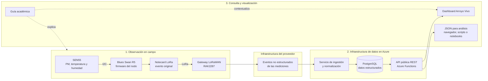

# Arroyo Vivo: nodo IoT ambiental

Repositorio académico del taller **Ciencia, tecnología y arte para el cuidado
del Arroyo Vivo**. El proyecto acompaña a estudiantes y docentes en la
construcción de nodos IoT capaces de medir condiciones ambientales, transmitir
las observaciones y convertirlas en información accesible para su análisis.

El sitio reúne la guía del taller, firmware de referencia, recursos técnicos y
un dashboard público. Los nodos reciben nombres de animales: actualmente se
encuentran registrados **Colibrí** (equipo 1) y **Mariposa** (equipo 2).

## Recursos públicos

| Recurso | Contenido | Acceso |
|---|---|---|
| Sitio y guía académica | Sesiones, actividades y materiales del taller | [Abrir sitio](https://centrofuturociudades.github.io/mi-primer-nodo-iot-ambiental/) |
| Dashboard | Mapa, última lectura e histórico de cada nodo | [Abrir dashboard](https://centrofuturociudades.github.io/mi-primer-nodo-iot-ambiental/dashboard) |
| Dispositivos | Inventario de sensores y gateway con su última medición | [Consultar JSON](https://arroyo-vivo-ingest-enbvbvh3b9f8azc3.westus2-01.azurewebsites.net/api/devices) |
| Histórico de Colibrí | Mediciones estructuradas del equipo 1 | [Consultar JSON](https://arroyo-vivo-ingest-enbvbvh3b9f8azc3.westus2-01.azurewebsites.net/api/devices/team/1/measurements?limit=200) |
| Histórico de Mariposa | Mediciones estructuradas del equipo 2 | [Consultar JSON](https://arroyo-vivo-ingest-enbvbvh3b9f8azc3.westus2-01.azurewebsites.net/api/devices/team/2/measurements?limit=200) |
| Código fuente | Sitio, dashboard, documentación y firmware | [Abrir repositorio](https://github.com/CentroFuturoCiudades/mi-primer-nodo-iot-ambiental) |

Los enlaces JSON pueden abrirse directamente en un navegador; no es necesario
instalar `curl` ni otra herramienta. El parámetro `limit` controla cuántas
mediciones devuelve el histórico, por ejemplo `limit=20` o `limit=200`.

## Tres niveles de acceso a los datos

El proyecto ofrece tres niveles complementarios. Esta separación permite
conservar el evento original, disponer de datos comparables para investigación
y presentar los resultados de forma comprensible.

1. **Eventos originales.** El nodo mide con el SEN55 y genera eventos en la
   infraestructura del proveedor de conectividad. Es la capa de menor nivel:
   conserva la carga útil recibida antes de transformarla. Su administración
   depende de la cuenta del proveedor y puede requerir credenciales.
2. **Datos estructurados.** Una capa de ingestión en Azure recibe, valida y
   organiza los eventos en una base de datos PostgreSQL. Una API pública expone
   dispositivos, últimas lecturas e históricos como JSON.
3. **Visualización.** El dashboard consulta la API y presenta los nodos sobre
   un mapa, sus métricas actuales y series históricas. La guía académica ayuda
   a interpretar el proceso completo, desde el sensor hasta la gráfica.



## API de datos estructurados

URL base:

```text
https://arroyo-vivo-ingest-enbvbvh3b9f8azc3.westus2-01.azurewebsites.net/api
```

| Método y ruta | Descripción |
|---|---|
| `GET /devices` | Lista los dispositivos activos, su ubicación y `last_measurement`. |
| `GET /devices/team/1/measurements?limit=200` | Devuelve el histórico de Colibrí. |
| `GET /devices/team/2/measurements?limit=200` | Devuelve el histórico de Mariposa. |

Los históricos se consultan por `team_id`, no por `device_uid`. Cada registro
puede incluir `time`, `pm25`, `pm10`, `pm40`, `pm100`, `temperature` y
`humidity`. Las fechas se entregan en formato ISO 8601 y los valores faltantes
pueden aparecer como `null`.

Ejemplo con terminal:

```bash
curl -sS "https://arroyo-vivo-ingest-enbvbvh3b9f8azc3.westus2-01.azurewebsites.net/api/devices/team/1/measurements?limit=20" | jq
```

La API constituye la fuente estructurada para el dashboard y para análisis
externos. El dashboard aplica filtros visuales a lecturas físicamente fuera de
rango para evitar que un valor anómalo distorsione las gráficas; los datos
originales permanecen disponibles en las capas anteriores para revisión y
trazabilidad.

## Infraestructura en Azure

La capa desplegada en Azure cumple tres responsabilidades:

- recibir y transformar los eventos enviados por los nodos;
- persistir las mediciones y metadatos de dispositivos en PostgreSQL;
- publicar endpoints HTTP de solo consulta mediante Azure Functions.

El sitio Docusaurus se publica por separado en GitHub Pages y consume estos
endpoints desde el navegador. Esta arquitectura desacopla la captura, el
almacenamiento y la presentación: el dashboard puede evolucionar sin modificar
el firmware, y los datos también pueden utilizarse en notebooks, hojas de
cálculo u otras visualizaciones.

> Los endpoints son públicos para fines académicos. No deben publicarse en el
> repositorio cadenas de conexión, claves de Azure, credenciales de PostgreSQL
> ni secretos del proveedor de conectividad.

## Variables ambientales

| Campo | Interpretación | Unidad |
|---|---|---|
| `pm25` | Partículas con diámetro aerodinámico de hasta 2.5 micras | µg/m³ |
| `pm10` | Partículas con diámetro aerodinámico de hasta 10 micras | µg/m³ |
| `temperature` | Temperatura del aire registrada por el nodo | °C |
| `humidity` | Humedad relativa | % |

Las mediciones son observaciones ambientales con fines educativos. Antes de
usarlas en investigación o toma de decisiones deben revisarse la calibración,
ubicación, mantenimiento, continuidad temporal y posibles valores atípicos.

## Desarrollo local

Se requiere Node.js 20 o superior.

```bash
npm install
npm run start
```

El servidor local se abre normalmente en `http://localhost:3000`. Para validar
una versión de producción:

```bash
npm run build
npm run serve
```

El contenido principal se encuentra en `docs/`, el dashboard en
`src/pages/dashboard.jsx`, los estilos en `src/css/custom.css` y los programas
de referencia en `static/codigos/`.

## Propósito y alcance

Arroyo Vivo conecta electrónica, programación, ciencia ambiental y lectura
crítica de datos. Su propósito no es solamente construir un sensor: busca que
las y los participantes comprendan el recorrido de una observación, documenten
su calidad y puedan comunicarla como evidencia sobre el entorno compartido.
