# Arroyo Vivo: ciencia, tecnología y acción ambiental

Repositorio del taller **Ciencia, tecnología y arte para el cuidado del Arroyo
Vivo**. Durante cuatro sesiones, las y los participantes observan el territorio,
construyen nodos IoT, interpretan mediciones ambientales y convierten la
evidencia en propuestas para su comunidad.

Este repositorio reúne la guía académica, el firmware, la arquitectura de datos
y el dashboard. La tecnología es una parte del proceso pedagógico, no el fin:
los sensores complementan la observación del lugar y ayudan a formular mejores
preguntas sobre el entorno.

## Accesos principales

| Recurso | Para qué sirve | Enlace |
|---|---|---|
| Sitio del taller | Guía, actividades y materiales de las cuatro sesiones | [Abrir sitio](https://centrofuturociudades.github.io/mi-primer-nodo-iot-ambiental/) |
| Eventos en Notehub | Capa original de eventos generados por los nodos | [Abrir eventos](https://notehub.io/project/app:6242a418-352c-4e90-97bc-9780b411148b/events) |
| API pública | Datos estructurados almacenados en PostgreSQL | [Abrir dispositivos](https://arroyo-vivo-ingest-enbvbvh3b9f8azc3.westus2-01.azurewebsites.net/api/devices) |
| Dashboard | Mapa, última lectura e histórico ambiental | [Abrir dashboard](https://centrofuturociudades.github.io/mi-primer-nodo-iot-ambiental/dashboard) |
| Repositorio | Código del sitio, dashboard, documentación y firmware | [Abrir GitHub](https://github.com/CentroFuturoCiudades/mi-primer-nodo-iot-ambiental) |

Los datos estructurados son públicos y pueden consultarse directamente desde un
navegador, un script o un notebook. El acceso a la vista de eventos originales
puede depender de la sesión y los permisos configurados en Notehub.

## El taller en cuatro sesiones

| Sesión | Pregunta central | Trabajo y resultado |
|---|---|---|
| **1. Entender el arroyo** | ¿Qué ocurre en el entorno y qué queremos comprender? | Observación, mapa colectivo, percepción ambiental, bitácora y una pregunta inicial por equipo. |
| **2. Tecnología para medir** | ¿Cómo convertimos una condición ambiental en un dato? | Programación de la Blues Swan R5, lectura del SEN55, integración de Notecard/LoRa y construcción del nodo IoT. |
| **3. Procesar y visualizar** | ¿Qué patrones y diferencias muestran las mediciones? | Organización, comparación e interpretación de datos; creación de gráficas y tableros. |
| **4. Reflexionar y accionar** | ¿Qué podemos proponer a partir de la evidencia? | Comunicación de hallazgos, reflexión colectiva y tres acciones o propuestas por equipo. |

La arquitectura tecnológica documentada abajo forma parte principalmente de la
**sesión 2**. Sus datos alimentan la visualización de la **sesión 3** y sirven
como evidencia para la reflexión y las propuestas de la **sesión 4**.

## Tres niveles para consumir los datos

### 1. Eventos originales: Notehub

El sensor **SEN55** mide partículas suspendidas, temperatura y humedad. La
**Blues Swan R5** prepara la lectura y la **Notecard LoRa** la transmite mediante
el gateway. Notehub recibe cada envío como un evento asociado al proyecto.

Esta es la capa de más bajo nivel: permite inspeccionar el mensaje recibido,
metadatos del dispositivo y eventos de comunicación antes de convertirlos a un
modelo tabular.

[Consultar los eventos del proyecto en Notehub](https://notehub.io/project/app:6242a418-352c-4e90-97bc-9780b411148b/events)

### 2. Datos estructurados: Azure y PostgreSQL

En Notehub se configuró una **Route** (enrutador) que envía los eventos por HTTP
a una **Azure Function** de ingestión. La función interpreta la carga útil,
normaliza campos como equipo, fecha y variables ambientales, y escribe el
resultado en una base de datos **PostgreSQL alojada en Azure**.

La misma capa de aplicación publica endpoints HTTP de consulta. Estos endpoints
son abiertos y de solo lectura: no exponen credenciales de PostgreSQL y evitan
que cada consumidor tenga que conocer el esquema interno de la base.

### 3. Visualización: dashboard en GitHub Pages

El dashboard está construido con Docusaurus y React, se publica mediante
**GitHub Pages** y consulta la API desde el navegador. Presenta los dispositivos
en un mapa, la última medición y el histórico de PM2.5, PM10, temperatura y
humedad.

Los nodos reciben nombres de animales. Actualmente están identificados
**Colibrí** (`team_id=1`) y **Mariposa** (`team_id=2`), además del gateway de
infraestructura.

## Arquitectura completa

```mermaid
flowchart LR
    subgraph Campo["Campo y nodo IoT"]
        S["SEN55<br/>PM, temperatura y humedad"]
        M["Blues Swan R5<br/>firmware"]
        N["Notecard LoRa"]
        G["Gateway LoRaWAN<br/>RAK2287"]
        S -->|"I2C"| M
        M -->|"crea la medición"| N
        N -->|"LoRa"| G
    end

    subgraph Nivel1["Nivel 1 · Eventos originales"]
        NH["Notehub<br/>eventos y metadatos"]
        R["Route de Notehub<br/>envío HTTP"]
        NH --> R
    end

    subgraph Nivel2["Nivel 2 · Datos estructurados en Azure"]
        FI["Azure Function<br/>ingesta y normalización"]
        PG[("PostgreSQL<br/>mediciones y dispositivos")]
        FQ["Azure Functions<br/>API pública REST"]
        FI -->|"INSERT"| PG
        PG -->|"consultas SQL"| FQ
    end

    subgraph Nivel3["Nivel 3 · Acceso y visualización"]
        JSON["JSON público<br/>navegador, scripts y notebooks"]
        WEB["Dashboard Docusaurus<br/>GitHub Pages"]
        USERS["Estudiantes, docentes,<br/>urbanismo y equipo técnico"]
        FQ --> JSON
        FQ -->|"fetch"| WEB
        JSON --> USERS
        WEB --> USERS
    end

    REPO["Repositorio GitHub<br/>código y guía académica"]

    G -->|"Internet"| NH
    R -->|"POST del evento"| FI
    REPO -.->|"despliegue"| WEB
```



El recorrido puede leerse de izquierda a derecha: una observación física se
convierte en evento, el evento se estructura y persiste, y finalmente se
consulta como JSON o se comunica mediante el dashboard.

## Documentación breve de la API pública

URL base:

```text
https://arroyo-vivo-ingest-enbvbvh3b9f8azc3.westus2-01.azurewebsites.net/api
```

La API acepta solicitudes `GET`, responde en JSON y no requiere credenciales
para estos recursos de consulta.

| Endpoint | Respuesta |
|---|---|
| `GET /devices` | Dispositivos activos, ubicación, tipo, equipo y última medición. |
| `GET /devices/team/{team_id}/measurements?limit={n}` | Histórico del equipo solicitado, limitado a `n` registros. |

Campos principales:

| Campo | Significado | Unidad o formato |
|---|---|---|
| `device_uid` | Identificador técnico del dispositivo | texto |
| `team_id` | Equipo al que pertenece el nodo | entero |
| `time` / `recorded_at` | Momento de la medición | ISO 8601 |
| `pm25`, `pm10` | Concentración de partículas | µg/m³ |
| `temperature` | Temperatura registrada | °C |
| `humidity` | Humedad relativa | % |

Los históricos se consultan por `team_id`, no por `device_uid`. El parámetro
`limit` permite controlar el tamaño de la respuesta; por ejemplo, `limit=20`
devuelve hasta 20 mediciones y `limit=200`, hasta 200.

## Ejemplos de endpoints

Estos enlaces se pueden abrir directamente, incluso en un equipo sin `curl`:

- [Todos los dispositivos y su última medición](https://arroyo-vivo-ingest-enbvbvh3b9f8azc3.westus2-01.azurewebsites.net/api/devices)
- [Histórico de Colibrí, equipo 1](https://arroyo-vivo-ingest-enbvbvh3b9f8azc3.westus2-01.azurewebsites.net/api/devices/team/1/measurements?limit=200)
- [Histórico de Mariposa, equipo 2](https://arroyo-vivo-ingest-enbvbvh3b9f8azc3.westus2-01.azurewebsites.net/api/devices/team/2/measurements?limit=200)

Ejemplo desde terminal:

```bash
curl -sS "https://arroyo-vivo-ingest-enbvbvh3b9f8azc3.westus2-01.azurewebsites.net/api/devices/team/1/measurements?limit=20" | jq
```

Una respuesta histórica tiene esta forma:

```json
[
  {
    "time": "2026-07-04T12:13:46+00:00",
    "pm25": 23.4,
    "pm10": 21.9,
    "temperature": 25.93,
    "humidity": 74.74
  }
]
```

## Lectura responsable de los datos

Las mediciones son observaciones ambientales para aprendizaje y exploración.
Su interpretación debe considerar ubicación, exposición, calibración,
mantenimiento, continuidad temporal y posibles valores atípicos.

La API conserva los datos estructurados disponibles para análisis. El dashboard
aplica filtros de visualización a lecturas fuera de rango para impedir que una
anomalía de sensor distorsione las gráficas; esto no sustituye un proceso formal
de validación científica.

## Desarrollo local

Se requiere Node.js 20 o superior.

```bash
npm install
npm run start
```

El sitio se abre normalmente en `http://localhost:3000`. Para validar la
compilación de producción:

```bash
npm run build
npm run serve
```

Rutas principales del repositorio:

- `docs/`: sesiones y actividades académicas;
- `static/codigos/`: firmware y programas de referencia;
- `src/pages/dashboard.jsx`: consulta de la API y visualización;
- `src/css/custom.css`: estilos del sitio y dashboard.

## Seguridad y alcance

El dashboard y los endpoints de consulta son públicos para facilitar el uso
académico de los datos. Las cadenas de conexión, claves de Azure, credenciales
de PostgreSQL y secretos de Notehub no deben incluirse en el repositorio ni
entregarse a los clientes web.
